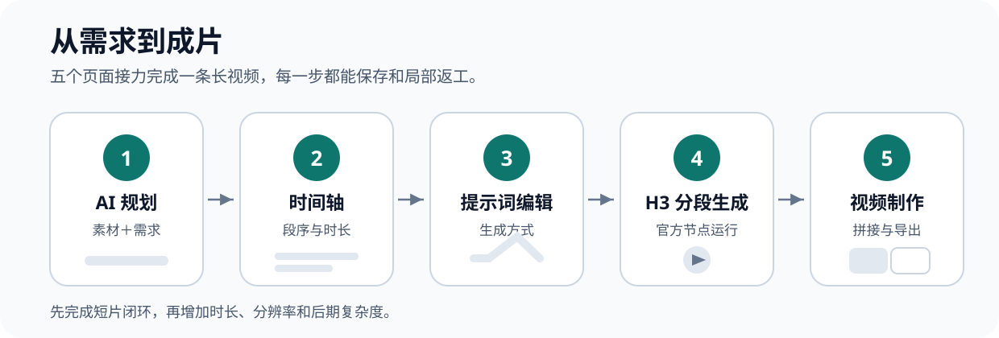
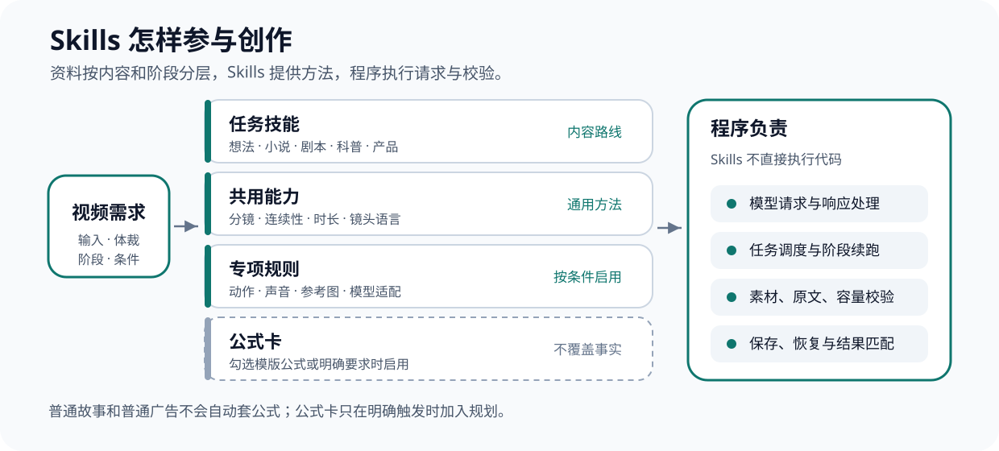
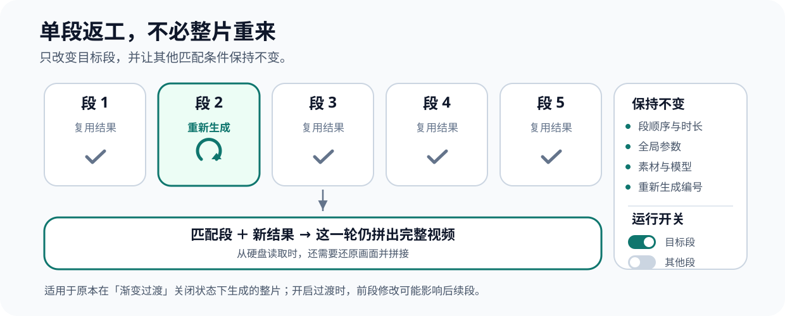

# AI视频规划师

[简体中文](./README.md) · [English](./README_EN.md)

> **导语｜把一条长视频拆成可执行的小段。**
>
> 这是一个 ComfyUI 插件：AI 负责规划与提示词，官方 MiniMax H3 节点负责生成，插件负责拆段、续拍、拼接与后期衔接。


*图 1.1｜AI视频规划师主界面：从需求、分镜到时间轴与视频制作。*

> **好视频＝明确的目标 × 合适的结构 × 可执行的镜头 × 可控的节奏。**

## 目录

> **00 / 导语｜先选路线，再读细节。** 这份文档按“环境 → 创作 → 素材 → 复用 → 保存 → 优化”的顺序组织，第一次使用建议从第 01 章顺着读。

| 章节 | 主题 | 适合什么时候读 |
|---|---|---|
| **01** | [安装](#安装) | 第一次安装，或更新插件后 |
| **02** | [开始使用](#开始使用) | 想完整跑通一条视频 |
| **03** | [Skills 创作资料](#skills-创作资料) | 想了解或扩充创作规则 |
| **04** | [素材与模型](#素材与模型) | 配置 AI 服务、参考图或素材 |
| **05** | [单段修改与结果复用](#单段修改与结果复用) | 已经生成，只想改局部 |
| **06** | [保存与恢复](#保存与恢复) | 保存、分享或恢复工程 |
| **07** | [放大与加速](#放大与加速) | 想提高画质或生成速度 |
| **08** | [常见问题](#常见问题) | 遇到保存、请求或生成问题 |
| **09** | [资料与反馈](#资料与反馈) | 自定义资料或提交问题 |
| **10** | [更新记录](#更新记录) | 查看能力变化 |
| **附录** | [致谢](#致谢) · [支持作者](#支持作者) | 了解来源与支持项目 |

---

## 安装

> **01 / 导语｜先让环境跑通，再追求长度和画质。** 本章只解决安装、依赖和启动；先用短片确认模型与节点可用。

需要已带有官方 MiniMax H3 节点的 ComfyUI，以及 H3 主模型、Qwen3-VL 编码器、视频 VAE 和音频 VAE。建议先用短片确认环境可用，再增加时长和分辨率。

1. 下载本仓库，解压到 `ComfyUI/custom_nodes/ComfyUI-AI-Video-Planner/`；也可以使用下面的命令安装。
2. 在插件目录，用**运行 ComfyUI 的 Python 环境**安装依赖；便携版请使用内置 Python。
3. 重启 ComfyUI 并刷新网页，搜索节点「AI视频规划师」，确认页面底部出现同名面板。

```bash
cd ComfyUI/custom_nodes
git clone https://github.com/a63976659/ComfyUI-AI-Video-Planner
cd ComfyUI-AI-Video-Planner
python -m pip install -r requirements.txt
```

更新插件后同样需要重启 ComfyUI 并刷新网页。

<details>
<summary>按需安装的额外功能</summary>

视频相关依赖可在 `requirements.txt` 中取消对应项的注释后安装；三种本地配音各用自己的 `.venv-shared`，共同复用当前 ComfyUI 的 Python、Torch 和 GPU 运行库。

| 功能 | 需要准备 |
|---|---|
| 读取参考视频 | `imageio`，以及 `imageio-ffmpeg` 或 `av` |
| 视频制作与导出 | 完整 FFmpeg 和 `ffprobe`，含 `libx264`、AAC、`libass` 及中文字库 |
| Qwen3-TTS 本地配音 | [Qwen-TTS 配置](文档/技术实现/Qwen-TTS本地配音.md)，模型放在 `ComfyUI/models/TTS/` |
| IndexTTS-2.5 本地配音 | [IndexTTS-2.5 配置](文档/技术实现/IndexTTS-2.5本地配音.md)，模型放在 `ComfyUI/models/TTS/IndexTTS-2/` |
| Breeze-TTS-2 本地配音 | [Breeze-TTS-2 配置](文档/技术实现/Breeze-TTS-2本地配音.md)，模型放在 `ComfyUI/models/TTS/Breeze-TTS-2/` |

三种本地配音使用同一个[安装入口与共享宿主环境规则](文档/技术实现/本地配音便携环境.md)，可分别安装或检查；移动安装目录后会自动重新定位。

</details>

> **一句话记住｜先用短片确认环境，再增加时长和分辨率。**

---

## 开始使用

> **02 / 导语｜四步走完一次最小创作闭环。** 先导入工作流，再完成规划、时间轴和成片；每一步都可以保存，不需要一次做对。

### 1. 导入工作流

首次使用建议导入 [基础工作流](./workflows/AI长视频规划师V3.6.json)，选择已下载的模型，再打开底部「AI视频规划师」面板。

| 页面 | 用来做什么 |
|---|---|
| **AI规划** | 上传素材、填写需求，让 AI 设计分镜 |
| **提示词时间轴** | 调整分镜顺序与时长，生成各段提示词 |
| **提示词编辑** | 编辑节点中的每一段，设置生成方式与参考素材 |
| **视频制作** | 接收生成的视频，裁剪、调整声音、加字幕和音乐，导出成片 |

**方法卡｜最小创作闭环**

| 模块 | 内容 |
|---|---|
| **核心** | 先完成一条可播放、可保存的短片，再逐步增加复杂度 |
| **公式** | 导入工作流 → 生成分镜 → 调整并填充节点 → 运行并制作成片 |
| **案例** | 第一次使用时，用少量素材和较短时长验证整条流程 |
| **适合领域** | 环境确认、新用户上手、更换模型后的快速试做 |



*图 2.1｜从素材、分镜、提示词到成片的最小创作闭环。*

### 2. 生成分镜

在「AI规划」上传素材，选择用途或保留「自动识别」，填写想法、正文及必须保留的内容；输入 `@` 可以引用已上传素材。

**总时长以分钟填写，默认 0，表示自动分配。** 填入非零值时按目标总时长安排；内容或台词装不下时会提示调整。

点击「生成规划」，依次完成 **分析素材 → 规划剧集 → 生成参考 → 生成分镜**。未启用自动参考图时会跳过绘图；已完成的阶段和镜头会保存，可点击步骤查看。

也可以跳过 AI 规划，直接在节点时间轴添加分段，手工写提示词。

### 3. 调整并填充节点

在「提示词时间轴」检查草稿，拖动段卡调整顺序和时长，按需分割、删除或新增分段；时间轴支持缩放和横向移动。

选好需要处理的段，点击「AI生成提示词」；后台对每个目标段分别发起一次请求，结果按段返回。生成过程中可以停止，已完成的段会保留。满意后点击 **「填充节点」**，再到「提示词编辑」检查各段的提示词、生成方式、素材和首尾帧。

- 「上一步／下一步」最多保留 20 步，历史单独存入本地 `历史编辑缓存/编辑历史/`；加载工作流时有匹配缓存才能恢复，工作流文件不携带历史。
- 字幕在「视频制作」中编辑和导出。
- 编辑页的「提示词优化」只处理当前段文字；「审查标签」用于检查没有对应素材的引用。

### 4. 运行并制作成片

点击 ComfyUI 的 **运行（Queue Prompt）**。每段完成后会存到硬盘，最后统一还原成画面并拼接；底部面板显示进度。

「视频制作」自动接收当前工作流生成的视频，可继续裁剪、排序、调整已有声音、加字幕和背景音乐，再预览、导出。首次导入的视频会设置画布，后续片段沿用画布设置。

详细操作见 [视频制作说明](./文档/技术实现/2026-10-05-视频制作后期调整说明.md)。

<details>
<summary>手工连接节点</summary>

| 输入口 | 连接内容 |
|---|---|
| `fl2va模型` | 文字、图片或首尾帧生视频所需模型，用到时连接 |
| `ref2va模型` | 参考素材生视频、视频改视频所需模型，用到时连接 |
| `CLIP编码器` | minimax 类型的 Qwen3-VL 编码器，必接 |
| `视频VAE` / `音频VAE` | 对应的视频和音频处理模型，必接 |
| `SelfLift配置` | 可选，见下方放大与加速说明 |

输出包括图像、音频、帧率、总帧数和报告，可接预览或保存节点；「初采产物」供可选的「放大和重绘」节点使用。

</details>

> **一句话记住｜先跑通短片，再逐步增加时长、分辨率和后期复杂度。**

---

## Skills 创作资料

> **03 / 导语｜让创作方法各司其职。** 任务技能决定怎么理解内容，共用能力提供通用方法，专项规则解决具体问题，公式卡按需补充结构。

`Skills/` 是随插件提供的创作规则库。AI 规划时会根据视频需求自动选用通用能力、专项规则和任务技能，不需要手动挑选技能。



*图 3.1｜创作资料按任务和阶段装配，程序负责请求、调度、校验与保存。*

### 特点

- **按需自动装配**：结合输入类型、目标体裁、改写方式、规划阶段和触发条件选用资料，核心正文去重加载，参考细则按当前任务读取。
- **规则分层**：任务技能、共用能力、专项规则和公式卡分开维护，既有通用方法，也有针对题材和制作问题的专项能力。
- **约束边界清楚**：用户要求、原文事实、产品事实、时长和声音方案优先于公式或风格建议；素材、覆盖、容量和格式仍由程序校验。
- **职责明确**：Skills 只提供创作方法，不执行代码；模型请求、任务调度、结果校验和保存恢复由插件程序负责。
- **方便继续扩充**：可以在现有目录中增加专项规则、参考资料或公式卡，不需要改动其他需求类型。

### 能力

- 识别想法、小说、剧本、科普、产品等输入，确定内容规划路线与改写方式。
- 安排内容结构、集数、场次、镜头顺序、时长、台词容量和执行可行性。
- 设计人物、场景、道具、动作因果、镜头语言、参考图与空间预演。
- 处理人物场景连续性、对白与声音、模型适配和成片问题预防。
- 需要固定叙事骨架时，可提供「模版公式」等宏观结构，不覆盖用户既定事实和主结构。

### 覆盖范围

- **任务技能**：想法发展、小说改编、剧本保真、科普讲解、产品展示、需求识别。
- **共用能力**：分镜结构、通用镜头设计、人物场景连续性、时长与执行可行性。
- **专项规则**：世界规则与空间、人物造型、内容创意、动作战斗、参考图预演、场次叙事、成片预防、模型适配、物体变化、表演声音、镜头语言、题材表达。
- **公式卡**：通用视频公式，后续可继续添加其他公式。

普通故事和普通广告不会自动套公式；只有勾选「模版公式」或明确要求公式、叙事骨架、结构模板时才启用。

目录结构与自定义方式见 [skills技能体系图解](skills技能体系图解.pdf) 

> **一句话记住｜Skills 提供方法，程序负责执行与校验。**

---

## 素材与模型

> **04 / 导语｜先把服务、素材和生成入口接好。** 模型负责理解与生成，插件负责把素材送到正确位置，并检查能力是否匹配。

### 配置 AI 服务

打开 **ComfyUI 设置 → 🎬 AI视频规划师 → API 模型配置**，填写服务地址、模型名和密钥，测试连通后保存。支持预设服务及兼容 OpenAI 接口的云端或本地服务。

**本地起幅复核**使用 ComfyUI 模型目录下的 `LLM/Qwen3.5-9B`。当首个叙事镜头缺少定位字段、程序无法从原有起幅直接确认时，插件按需在 NVIDIA CUDA 上运行一次离线短文本判断。确认后只记录逐字引用的起幅证据。模型列表中的「检查本地模型」可检查运行环境，主规划继续使用「AI规划模型」所选的 API。

可以分别选择「AI规划模型」「时间轴改写模型」「提示词优化模型」；未单独选择时使用默认模型。规划服务需要支持你上传的素材类型；两处提示词改写只发送文字。

模型响应较慢时可调整请求超时；时间轴改写和编辑页优化每次最多等待 600 秒，配置更短时按较短值执行。

### 用 ComfyUI 工作流生成规划参考图

1. 在 ComfyUI 画布准备能输出单张图像的本地工作流。用「保存图像」或「预览图像」作为输出，有多个图像输出时，将目标节点命名为「LVP 输出图」。
2. 用「导出（API）」保存 JSON，把文件放进本插件的 [workflows/生图](./workflows/生图) 目录。
3. 在「API 模型配置 → 图像模型」里选择「ComfyUI 本地工作流」，选好「文生图工作流」并保存。开启规划页的「生成参考图」后，任务会在当前 ComfyUI 队列运行，图片会加入规划素材。

每个角色由图像模型一次生成一张横排四视图身份图，从左到右是正面面颈特写、全身正面、鼻尖朝左的全身正侧面、全身背面。提示词引导三个全身视图保持同尺度、头脚对齐，双臂自然下垂并微张约 15°。四视图用于身份参考，首尾帧使用单独的镜头图片。建议文生图及图生图工作流采用横向画幅。

每件道具由图像模型一次出图。剧情只用到照片、海报等道具的画面时，生成一张完整的正面图。需要参考实物结构时，依次展示正面、侧面、背面。剧情涉及开盖、合上或折展时，在同一张图中分行展示各个关键状态，分镜按当时的状态引用。道具表面的照片或图案随实物转面，保留图内构图。

需要用用户上传的图片生图时，再配置「图生图工作流」。

- 规划器沿采样器的正向连线寻找唯一的文本编码入口。常见的 CLIP、SDXL、SD3、FLUX 和 Qwen 图像编码节点可以直接填词；多文本框的编码节点会填入各正向文本框。负向提示词沿用工作流设置。Qwen 图像 2.1 的负向留空时，角色和道具设定图默认排除文字、边框和分格线等；场景图默认排除文字、水印、标注和拼图。
- 编码节点有可识别的图片端口时，规划器按选图顺序接入，可复用已有的加载和处理链路，也可连接空端口。参考图只走独立支路，或加载来源无法确定时，将对应「加载图像」节点依次命名为「LVP 参考图 1」「LVP 参考图 2」等，数量须与当次选图一致。
- 正向入口无法唯一确定，或需要保留正向文本的加工连线时，把目标文本输入设为 `{{LVP_PROMPT}}`。

自动填入只作用于本次排队的任务。工作流里的模型、尺寸和采样参数按文件执行。

### 规划素材与分段素材

| 位置 | 作用 |
|---|---|
| **AI规划的素材区** | 供 AI 理解内容和安排分镜，支持图片、视频、音频、文本 |
| **每段的参考素材区** | 供视频生成使用；H3 每段最多 9 张参考图、3 个参考视频、3 个参考音频，首尾帧按任务设置 |
| **视频制作的片段区** | 接收生成结果用于后期编辑，视频和配音只加入制作片段 |

**清空规划素材会清除草稿中对应的素材绑定。** 重新上传同名文件不会自动恢复引用；再次生成提示词或填充节点前，请逐段检查素材、首尾帧及引用标签。清空列表不会删除已保存到磁盘的原文件。

使用 DeepSeek 官方接口时，图片先上传再供同一规划任务重复使用，支持**单次最多 600 张图片**；上传文件设置 **7 天有效期**，任务结束、失败或取消后会尝试提前清理。图片格式、大小和总容量仍受所选服务限制；上传失败会显示原因，不自动改用另一种发送方式。官方说明：[图像理解](https://api-docs.deepseek.com/zh-cn/guides/vision/) · [文件上传](https://api-docs.deepseek.com/zh-cn/guides/files_api/)。

百炼北京接口支持完整上传图片、视频和音频，使用现有密钥，无需另配存储账号。不同服务的素材能力不同，详见 [素材发送说明](./文档/技术实现/2026-10-07-规划素材原件发送.md)。

<details>
<summary>共用素材与参考视频原声</summary>

以下功能适用于参考素材生视频、视频改视频及参考素材＋视频改视频：

- **全段共用**：视频画面、自带音轨和普通音频按各段时间范围连续读取，如前5秒、接下来的5秒；关闭后，各段从素材开头截取当前段时长。视频帧尾仅为模型网格补齐，不读取下一段内容；指定配音和背景音轨保留独立编排。
- **禁用**：点击视频素材，在预览弹窗开启后，仅禁止这条视频的音轨参与模型参考，视频画面仍正常输入。
- **原声**：在视频或音频预览弹窗开启后，将所选素材的音轨直接作为输出声音，不改变参考音频输入；视频的“禁用”可独立开启。要求节点帧率为 24，声音按画面长度裁剪或补静音。

同一素材组只能选择一个视频或音频作为原声输出，新选择会替换原选择。音频素材没有禁用开关；关闭原声后恢复原有生成方式。有声视频会占用音频引用编号，可在提示词的 `@` 列表中核对。

详见 [参考视频与音轨说明](./文档/技术实现/2026-10-05-参考视频音轨接入修复.md)。

</details>

> **一句话记住｜规划素材用于理解内容，分段素材用于生成，制作片段用于后期。**

---

## 单段修改与结果复用

> **05 / 导语｜把重做范围缩到真正改变的那一段。** 保持其他条件不变，才能复用已有结果；需要续拍或过渡时，再按依赖关系重做后续段。

参数、素材、模型和「重新生成编号」保持一致时，会复用已有结果。**开启「运行」表示允许生成，不代表强制重做；关闭后，有匹配结果的段仍会拼进成片。**

**方法卡｜局部重做**

| 模块 | 内容 |
|---|---|
| **核心** | 只重做目标段，其他段复用匹配结果 |
| **公式** | 修改目标段 → 只开启目标段运行 → 保持重新生成编号 → 运行 |
| **案例** | 渐变过渡关闭时，只修改第二段提示词，其余段保持不变 |
| **适合领域** | 局部返工、台词微调、单段更换素材 |



*图 5.1｜目标段重新生成，其他段复用匹配结果，再拼接为完整视频。*

### 只修改其中一段

适用于整片原本就在 **「渐变过渡」关闭** 的情况下生成：

1. 修改目标段的提示词或本段素材，保持其余段、段顺序、时长及全局设置不变。
2. 只开启目标段的「运行」，关闭其他段；**「重新生成编号」保持不变**。
3. 点击运行，目标段重新生成，其余段复用匹配结果；这一轮就会拼出完整视频。

其他段必须有可用结果，否则不会加入成片。之后再开启全部段运行，匹配的结果仍会复用；从硬盘读取时，还需要还原画面并拼接，耗时取决于片长和分辨率。

### 重新生成编号与渐变过渡

| 设置 | 影响 |
|---|---|
| **重新生成编号 +1** | 下次运行时让参与运行的段重新生成；作用于整个节点，不会立即启动 |
| **渐变过渡关闭** | 各段独立生成，便于单独修改 |
| **渐变过渡开启** | 把上一段结尾的一段画面（长度由「续拍秒数」选：0.2／0.9／1.6／2.3 秒，默认 0.9）和约 1 秒声音带入下一段，只把接缝开头的冷暖与明暗对齐到上一段末尾，不叠上一镜的画面；本段会自动多生成一点再裁掉开头，进成片的长度仍等于时间轴里设定的秒数；修改前段可能需要重做后续段 |

「渐变过渡」不会让两段画面交叉淡入淡出；**切换开关会改变所有段的结果匹配条件，需要重新生成**。运行开始后再切换，只影响后续运行。

「续拍秒数」不在节点上，改在时间轴工具条「渐变过渡」右侧的按钮里选；渐变过渡关着也能先把档设好，那时它不参与生成。

每次运行都会在报告里为每个接缝写一行实测数字：切点跳变、开头动势、重播度、色温补偿。换档前后对照这一行就能看出差别，不用凭印象。
需要留下画面对比时，在启动 ComfyUI 前设环境变量 `H3_接缝导出=1`，每个接缝前后各 12 帧会存成图片放到 `%TEMP%/长视频规划师_接缝诊断/`；这个目录不会自动清理，看完自行删除。

缓存工具条可以查看占用空间或清空分段结果。清空不可撤销；默认存放在 `%TEMP%/长视频规划师_段缓存/`。

> **一句话记住｜局部重做的关键，是只改变目标段，并保持其他匹配条件不变。**

---

## 保存与恢复

> **06 / 导语｜把创作状态和结果一起留住。** 工作流保存节点与页面内容，计划保存分段和素材引用，原文件仍需另外保管。

| 方式 | 适合什么场景 |
|---|---|
| **保存 ComfyUI 工作流** | 保存节点连线、参数和页面编辑内容，包括未提交的规划需求 |
| **计划数据 → 保存／加载** | 复用当前节点的配置、分段、素材引用和规划草稿；不包含「重新生成编号」 |
| **载入规划** | 从历史记录恢复原始分镜和阶段成果；会替换当前草稿，可用「上一步」找回 |
| **设置 → 数据管理** | 导入、导出或管理历史规划与计划 |

计划保存在插件的 `计划数据/` 目录。分享工程时，图片、视频、音频原文件需要另外提供；计划中的素材引用不会把原文件一并打包。

「预设」可把常用提示词加到每一段前面。将 `.txt` 文件放入 `预设/` 或其一层子文件夹，收起再展开面板即可刷新列表。

**重新开始创作**：节点时间轴的「重置」会在确认后清空当前节点的创作内容，保留连线、公共模型配置和磁盘文件；任务进行中需先停止或等待完成。

> **一句话记住｜工作流管当前工程，计划管可复用方案，原文件管素材本体。**

---

## 放大与加速

> **07 / 导语｜先确认基础流程，再按硬件条件提升画质与速度。** 放大、重绘和 SelfLift 各有独立设置与缓存，不需要初次安装就全部启用。

这些功能按需使用，初次安装可先完成基础流程。

| 功能 | 使用方式 |
|---|---|
| **放大和重绘** | 接主节点的「初采产物」，调整画面或放大；使用独立的结果缓存和重新生成编号 |
| **SelfLift加速** | 把「SelfLift配置」接入主节点，先以较小画面生成，再完成高清部分；使用 `euler`，两阶段至少各留一步 |

SelfLift 默认采用对口型采样。打开某段「运行」左侧的「关闭对口型」后，有唯一有效参考音频的段会在低清和高清采样中固定该音频。

H3 放大所需的[模型文件](https://huggingface.co/LBH-123-AI/Minimax_h3_latent_Upscaler)需自行下载，放入 `ComfyUI/models/latent_upscale_models/`；像素放大模型放入 `ComfyUI/models/upscale_models/`。不需要模型的 Lanczos 放大也可使用。SelfLift 未选择放大模型时需开启「允许插值降级」，建议仅用于预览。

示例工作流：[重绘放大加速版](./workflows/重绘放大加速版V3.6.json)。实际速度、画质和内存占用因硬件与设置而异。

<details>
<summary>可选的「初采交接与清理」节点</summary>

连接方式：**AI视频规划师 → 初采交接与清理 → 放大和重绘 → 保存**。

它先保存初次生成的数据，再请求释放内存，随后进行二次生成。仅支持一条明确的交接链，不支持批量、局部执行或跨阶段连线；使用时请保持队列独占，避免其他窗口同时提交任务。

中途停止会保留已落盘数据，但刷新页面不会自动续接旧交接任务。该功能仍缺少真实显卡、浏览器及完整保存链的联合验证；最终完整视频仍需占用内存。

</details>

> **一句话记住｜先短片试跑，再根据显存、时长和画质目标选择加速方式。**

---

## 常见问题

> **08 / 导语｜先判断问题发生在哪一步。** 保存、请求、生成和内存问题各有边界；保留已完成结果，通常比整片重来更快。

**刷新后如何保留内容？** 通过 ComfyUI 保存当前工作流，重要方案同时保存一份计划。加载旧工作流或旧计划会带回当时的内容；素材原文件需保留在对应位置。

**生成中断了怎么办？** 视频生成已完成的段会保留，下次运行可复用；未完成段需要重做。AI 规划可以主动继续未完成内容；提示词改写失败会保留原文与此前完成结果，不自动重发，可先禁用无需重写的段再重试。

**提示词生成时能切换窗口吗？** 后台任务可继续，回到页面后会接回结果；若实际修改了节点、分段或草稿，旧结果可能被丢弃，以免覆盖新内容。

**报 HTTP 413 是什么意思？** 发送的内容超过服务或中间服务器的限制。检查所选服务的素材能力、大小限制及是否走对应上传方式；大量图片可使用已适配的 DeepSeek 官方文件上传方式。

**“响应未接收完整”是什么问题？** 模型服务或连接提前中断，返回内容不完整；检查服务状态和网络后重试。

**生成长片需要多少内存？** 取决于模型、片长和分辨率。最终拼接需在内存中保留整片画面，长片可能需要数十 GB；建议先用较低分辨率和较短时长试跑。

**分辨率和帧率怎么选？** 画面大小由宽高比和「百万像素」共同决定，建议从较低值试起。H3 按每秒 24 帧生成；修改输出帧率会改变播放速度，不会改变生成时的运动设计。

**只连一个模型口可以吗？** 可以，只需连接当前分段任务用到的模型；缺少所需模型时会明确提示。

> **一句话记住｜先保留已完成内容，再定位失败阶段并针对性重试。**

---

## 资料与反馈

> **09 / 导语｜需要自定义或排错时，从对应入口查起。** 创作资料、来源许可与技术实现分开维护，反馈问题时附上完整上下文并遮盖密钥。

内容规划和提示词改写会自动读取随插件提供的创作资料，无需手动选择技能。需要自定义时可查看 [规划资料入口](./Skills/目录说明.md)、[提示词改写规则](./AI生成提示词/SKILL.md)和[目录说明](./文档/技术实现/Skills目录与装配说明.md)；来源及许可见[来源记录](./文档/参考/Skills来源清单.json)。

遇到问题请到 [Issues](https://github.com/a63976659/ComfyUI-AI-Video-Planner/issues) 反馈，附上操作步骤、完整报错、ComfyUI 版本、显卡与模型信息；注意遮盖密钥和私人内容。

> **一句话记住｜先查对应说明，再用可复现的步骤和脱敏信息反馈。**

---

## 更新记录

> **10 / 导语｜按时间查看能力变化。** 这里记录用户可感知的更新，最新用法以上方正文为准。

<details>
<summary>展开历史更新</summary>

最新用法见上面的说明。

- **2026-11-25** 播放源视频时会自动接着播下一段，时间线可以拖动，超过23个字的字幕会按标点拆开，页面预览和导出视频都能看到。
- **2026-11-24** 播放源视频时会按播放时间显示对应字幕，并沿用工程里的字幕样式。
- **2026-11-11** 补上了最近几天的更新说明。
- **2026-11-10** 做固定时长的视频时，会提前给后面的场景留时间，接着做也能用上已经画好的图和排好的场景。
- **2026-11-09** 每段可以单独决定接着拍还是换个画面，改写画面说明时也会保留原定时长。
- **2026-11-08** 这天的更新还需要确认。
- **2026-11-07** 一张道具图就能看到正面、侧面和背面，还能对照打开和合上的样子。
- **2026-11-06** 可以在自己电脑上画出人物、场景和道具，还能给人物画出不同角度。
- **2026-11-05** 写画面说明时会少重复图片里的细节，多交代人物怎么动、画面怎么变。
- **2026-11-04** 换到另一份视频方案时，屏幕底下会显示那一份的内容和进度。
- **2026-11-03** 可以用在线服务做视频，也可以单独关掉某一段的对口型。
- **2026-11-02** 这天的更新还需要确认。
- **2026-11-01** 说明里补上了三种配音工具的来源和用途。
- **2026-10-31** 很短的片段也能放大看清，每场戏的画面安排可以一次看全。
- **2026-10-30** 视频计划会一次写完整，列出用到的文件，并把台词和背景声音分开写。
- **2026-10-29** 打开过渡效果后，前后画面的明暗和颜色会更接近，每段也会按设定的长度播放。
- **2026-10-28** 多写个逗号之类的小错会自动修好，某段出错时也能看到具体原因。
- **2026-10-26** 多了一种在自己电脑上配音的方法，还能给台词加上笑声、叹气和咳嗽。
- **2026-10-25** 可以上传现成的录音当配音，也能从想听的位置开始试听。
- **2026-10-24** 配音有了单独的窗口，可以改台词、做新配音或挑选以前的录音。
- **2026-10-23** 改了一段的长度，后面的片段会自动挪到对应位置，总时长也会更新。
- **2026-10-22** 做视频计划时会按内容找合适的写法，接着做时也会用上之前读过的资料。
- **2026-10-21** 计划中途出错后，可以保留做好的内容，再接着补齐剩下的部分。
- **2026-10-20** 可以一次给最多三个人的对话配音，也能调整每句话之间的停顿和接话时间。
- **2026-10-19** 用图片做视频时，会自动选好开头那张图。
- **2026-10-18** 可以在自己电脑上做配音，也能把喜欢的声音、录音和头像存起来下次用。
- **2026-10-17** 可以给对白和旁白配音，选声音时还能先搜一搜、听一听。
- **2026-10-14** 修改记录会存在自己电脑上，改错了最多能退回二十步。
- **2026-10-13** 切到别的页面时，工具会继续写画面说明，回来就能看到做好的部分。
- **2026-10-12** 填好视频总长度后，会先给后面的场景留出时间。
- **2026-10-11** 工具会先看资料，再安排场景、准备图片和每段画面，也能自动分配时间。
- **2026-10-10** 剪视频时，预览放在中间，两边的设置和片段能各自滚动。
- **2026-10-09** 手动改完或让工具重写后，可以用「上一步」和「下一步」来回切换。
- **2026-10-08** 视频可以按你填的总长度来安排，填零就让工具按内容决定。
- **2026-10-07** 可以直接用原图、录音、视频和整篇文章做计划，中途出错也能找回做好的部分。
- **2026-10-06** 加了重置按钮，想重来时可以清空当前做的内容。
- **2026-10-05** 做好的视频会自动进入剪辑页面，剪短或调换片段时配音和字幕会跟着走。
- **2026-10-04** 把想做的视频写在一个框里，就能查看每步的结果，还能为人物、场景和道具做图。
- **2026-10-03** 长文章可以自动分成几集，做好的视频可以在单独的页面查看和保存。
- **2026-10-02** 可以按说话速度和停顿估算每段要多长，也能让整片长度随内容来定。
- **2026-10-01** 做计划时会按你的想法挑合适的写法，用不同颜色区分每段画面的用途。
- **2026-09-30** 图片、视频、录音和文字都能点开预览，写需求时打个「@」就能选文件。
- **2026-09-29** 底下分成写需求、排片段和改说明三页，做好的画面说明会分批显示。
- **2026-09-28** 可以在片段列表里关掉字幕，这个选择会和计划一起保存。
- **2026-09-27** 修好了上一步做完却接不上下一步的问题，放大画面时也能选要不要重画。
- **2026-09-26** 可以先做小画面再放大来省时间，用图片做视频时也能选要不要裁剪。
- **2026-09-25** 做好的画面可以单独放大和修整，继续下一步之前也可以先保存。
- **2026-09-24** 前后片段接得更顺，声音也会跟视频一样长。
- **2026-09-23** 把计划交给工具做视频时，每段都会显示这次选的文件。
- **2026-09-21** 可以用滚轮放大片段列表，换图后也能马上看到新的小图。
- **2026-09-20** 剪视频时，片段列表最多能放大四十倍，更容易对齐每一小段。
- **2026-09-19** 换了文件或改了前面的片段后，会自动重做受影响的部分，也能单独重试选中的片段。
- **2026-09-18** 片段会一直列在页面上，可以直接看详情，也能只选几段让工具写画面说明。
- **2026-09-17** 可以剪短、拆开、删除或调换片段，也能让工具单独为每段写画面说明。
- **2026-09-16** 填一个主题，工具就会帮你把视频分成几段，安排每段拍什么。
- **2026-09-15** 视频会先一段段保存再拼起来，电脑做长视频时负担更小，前后画面也接得更顺。
- **2026-09-14** 几种不同的片段可以混着做，工具会为每段自动选好做法。
- **2026-09-13** 画面大小现在按你设置的来，默认比以前小一些。
- **2026-09-12** 修好了声音文件读不出来、加片段时用错做法的问题。

**仍在计划中**

- 做完一段后，还能反复修改它的画面说明。

> 9 月 16 日到 18 日加上了用文件保存和打开整份计划，9 月 19 日加上了清理旧结果的按钮。

</details>

> **一句话记住｜回顾变化看这里，学习当前操作请回到对应章节。**

---

## 致谢

> **附录 A / 导语｜这个插件建立在许多开源项目与社区经验之上。** 以下按宿主、模型、配音、同类项目、资料与依赖分类致谢。

<details>
<summary>开源项目与作者名单</summary>

本插件站在许多优秀的开源项目、模型与工具之上。以下按类别列出开发过程中直接或间接借鉴、参考、依赖过的对象，向所有作者与社区致谢（如有遗漏，请开 Issue 指正）。

### 宿主与官方节点

- **[Comfy-Org / ComfyUI](https://github.com/Comfy-Org/ComfyUI)**：本插件的宿主环境。整个「规划 → 拆段 → 逐段跑 → 拼回」都构建在 ComfyUI 的 V3 节点接口、执行器和缓存机制之上；底部面板、设置页、主题配色也全部复用 ComfyUI 前端框架。
- **ComfyUI 官方 MiniMax H3 节点**：所有真正的视频/音频生成、采样、解码都由官方节点完成。本插件刻意「不改宿主、不复制一份宿主」，只在外面做安排和产物的裁切拼接。

### 生成与理解模型

- **[MiniMax H3](https://github.com/MiniMax-AI/MiniMax-H3)（稀宇科技 MiniMax）**：多段视频/音频生成的核心基座模型，本插件的 6 种任务和每秒 24 帧的时间基座都来自它。
- **[Qwen3-VL](https://github.com/QwenLM)（阿里巴巴通义千问团队）**：作为文本编码器，让模型看得懂提示词。
- **[Kimi](https://github.com/moonshotai)（月之暗面 Moonshot AI）／ [DeepSeek](https://github.com/deepseek-ai) 等兼容端点**：为「AI 一键规划、逐段提示词优化」提供大模型推理（走网络请求，不占显存）。预设模型为 Kimi-K3，同时支持自定义云端/本地（[Ollama](https://github.com/ollama/ollama)、[LM Studio](https://lmstudio.ai)）。

### 本地配音模型

- **[Qwen3-TTS](https://github.com/QwenLM/Qwen3-TTS)（阿里巴巴通义千问团队）**：为本地配音提供预设音色、声音设计与声音克隆能力。
- **[IndexTTS-2.5](https://github.com/index-tts/index-tts)（IndexTeam）**：为本地配音提供参考录音克隆与情绪控制，音色库使用其官方演示参考录音。
- **[Breeze-TTS-2](https://github.com/breezeblue-ai/breeze-tts)（BreezeBlue）**：为本地配音提供声音设计、声音克隆与表演控制能力。

### 同类与参照的开源项目

本插件在设计上参考了 H3 开源生态和同类 AI 视频工具的公开实现（详见 `文档/参考/` 的逐篇分析），特别感谢：

- **[ComfyUI-Artificial-Intelligence](https://github.com/a63976659/ComfyUI-Artificial-Intelligence)**：知识库加载器、按模型保存密钥的统一清单、连通性测试、报错信息提取等配置端设计参考/移植自该插件。
- **[AIMixer 导演台](https://github.com/AIMixer/ComfyUI_MiniMaxH3_Director)**、**[H3-Motion-Context](https://github.com/NikoDemon80/ComfyUI-H3-Motion-Context)**、**[H3-Multishot](https://github.com/jlucasmcrell/ComfyUI-H3-Multishot)**、**[H3-Codex-Drama](https://github.com/chiphoton/MiniMax-H3-Codex-Drama)**、**[H3-SelfLift](https://github.com/facok/comfyui-SelfLift)**：同为 MiniMax H3 生成管线的社区节点，段之间直接传内部数据、音频延续窗口、`context_length` 参数取值、「先跑样板段确认 / 不侵入宿主」等理念与它们相互印证。
- **[MoneyPrinterTurbo](https://github.com/harry0703/MoneyPrinterTurbo)（harry0703）**、**[video-shotcraft](https://github.com/Vincentwei1021/video-shotcraft) / [video-talkcraft](https://github.com/Vincentwei1021/video-talkcraft) / [anything2explainer](https://github.com/Vincentwei1021/anything2explainer)（基于 [Remotion](https://github.com/remotion-dev/remotion)）**：一站式短视频与「技能/配方卡/多重验收」方法层面的参照。
- **AIVideo_node**、**[NodeCraft AI](https://github.com/a63976659/ComfyUI-NodeCraft-AI) 知识库**：大模型调用重试、设置持久化与联动界面等局部实现的经验来源。

### 技能与知识库素材

- 内容规划资料位于 `Skills/`，时间轴改写方法位于 `AI生成提示词/`。目录结构及使用规则见 [Skills目录与装配说明](文档/技术实现/Skills目录与装配说明.md)。

### 依赖的库与工具

- **[PyTorch](https://github.com/pytorch/pytorch)（torch）**：数组运算、拼接和补静音等所有数值计算。
- **[FFmpeg](https://ffmpeg.org) / [imageio-ffmpeg](https://github.com/imageio/imageio-ffmpeg)**：音频转码和读参考视频画面的后端。
- **[soundfile](https://github.com/bastibe/python-soundfile)**：音频素材的时长与采样读取。
- **[NumPy](https://github.com/numpy/numpy) / [Pillow](https://github.com/python-pillow/Pillow) / [aiohttp](https://github.com/aio-libs/aiohttp)**：由 ComfyUI 主环境提供的数组、图像与异步网络请求能力。
- **[PySceneDetect](https://github.com/Breakthrough/PySceneDetect)（scenedetect）+ [OpenCV](https://github.com/opencv/opencv)（opencv-python-headless）**：可选的源视频自动分段。
- **[PyAV](https://github.com/PyAV-Org/PyAV)（av）**：可选的视频读取后端。
- **[pytest](https://github.com/pytest-dev/pytest)**：全部前后端测试。

### 其它

- 短视频分镜方法（钩子 / 开场 / 建立 / 递进 / 冲突 / 高潮 / 反转 / 结尾 / 行动号召等段落作用划分）参考了社区广泛流传的短视频创作范式。
- 感谢所有提交 Bug、反馈和改进代码的社区成员。

</details>

---

## 支持作者

> **附录 B / 导语｜让好工具被更多人看见。** Star、分享作品或自愿赞助，都能帮助项目继续维护。

如果这个插件帮到你了：

- **Star 本仓库**
- **分享你的作品**：用本插件做出的视频，欢迎在 Issue 里展示
- **赞助**：


*图 A.1｜赞助二维码 1。*


*图 A.2｜赞助二维码 2。*

### 感谢支持

- 感谢 QQ 网友 **石头**（34720803）的建议、帮助和红包打赏。
- 感谢 QQ 网友 **Sorry全场**（473148949）的红包打赏。

> **一句话记住｜如果插件帮到了你，欢迎 Star、分享作品或提供反馈。**

---

<p align="center">
  <sub>为 ComfyUI 社区用心打造</sub>
</p>
